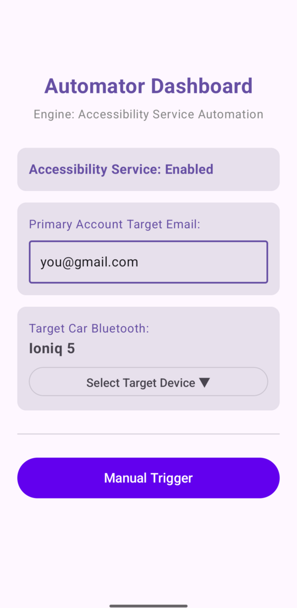

# Google Account Reset Automator

**Does Gemini or Google Assistant on Android Auto keep answering as your work or school account?**
Maybe "Hey Google" in the car says it can't do that with a Workspace account, or your personal
calendar, contacts and routines have gone missing. The Google app has quietly switched to a
secondary account, and Android Auto offers no way to switch it back.

This app switches it back for you: when your phone connects to your car's Bluetooth, it opens the
Google app's account switcher and picks your primary account, before you've pulled out of the
driveway.

## What it can and can't do

The app does the switch through an Android Accessibility Service, which is powerful, so here is
exactly what it uses:

- **No internet access.** The app doesn't request Android's network permission, so it can't send
  anything anywhere.
- **Only the Google app's account switcher.** The Accessibility Service only listens to the Google
  app (`com.google.android.googlequicksearchbox`) and only taps through its account switcher. The
  one exception is **Manual Trigger**, which afterwards also taps Force stop on Android Auto's App
  info page so Android Auto picks up the account.
- **Stores two settings:** your primary account's email and your car's Bluetooth name and address,
  on the phone only.
- **Open source:** the code is here, and every release is built by CI from this repository and
  signed with the same key.

## Known issue: phone locked for too long

If the phone is locked when the car connects, the app wakes the screen and waits for you to unlock
before switching. If it stays locked too long, the switch fails, and after that the app stops
working until you go to **Settings → Accessibility → Google Account Reset Automator**, turn it off,
and turn it back on.

## Overview
On BT connect or dock, the app automatically switches the Google app back to your configured
primary account. The switch is driven by an `AccessibilityService` that taps
through the Google app's own account-switcher UI — no root, no ADB pairing, and no clearing of app data.

### Core Architecture
- **`MainActivity.kt`**: Compose-based frontend to handle runtime Bluetooth permissions, configure the
  target vehicle and primary account email via `SharedPreferences`, show whether the Accessibility
  Service is enabled (with a link to Settings, since Android has no runtime prompt for it), and provide
  manual diagnostic execution.
- **`AutomatorReceiver.kt`**: A manifest-registered broadcast receiver listening for
  `BluetoothDevice.ACTION_ACL_CONNECTED` and `Intent.ACTION_DOCK_EVENT`. It matches the connected device
  by Bluetooth MAC address against the saved target car, then starts the switch (or, if the
  Accessibility Service is off, shows a notification linking to its settings).
- **`AccountSwitchAccessibilityService.kt`**: Launches the Google app and walks its accessibility node
  tree to open the account switcher and tap the row matching the saved primary email.

---

## Install

1. Download the APK from the [latest release](../../releases/latest), or add this repository to
   [Obtainium](https://github.com/ImranR98/Obtainium) to get updates automatically.
2. Open it on your phone. Android will ask you to allow installs from that source (your browser or
   file manager) the first time.
3. Follow the one-time device setup below.

Requires Android 11 (API 30) or newer.

---

## Build & Environment Setup

### Prerequisites
1. **Android Studio** (Ladybug or newer recommended)
2. **Android SDK 36**
3. **Java Development Kit (JDK) 17**

### Step 1: Clone and Project Initialization
Open the project folder inside Android Studio. Ensure your project level `build.gradle.kts` configuration
aligns with standard Android Gradle Plugin (AGP) version dependencies.

### Step 2: One-Time Device Setup
After installing the app:
1. Set your primary account email and pick the target car from the paired Bluetooth device list.
2. Enable the service under **Settings → Accessibility → Google Account Reset Automator** — Android has
   no in-app permission dialog for this, it must be granted manually.
